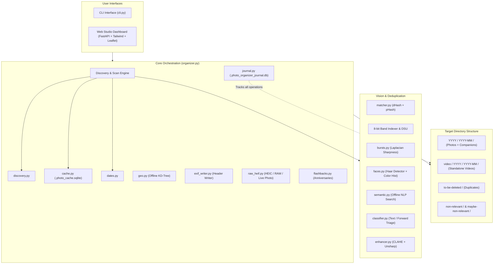

# Photo Organizer Studio — Architectural Design Specification

## 1. System Overview & Philosophy

**Photo Organizer Studio** is an autonomous, non-destructive media curation and cataloging engine designed to handle large, heterogeneous photo and video libraries (e.g., iPhone Live Photos, WhatsApp media dumps, DSLR RAW files, scanned prints).

### Core Architectural Principles

1. **Strict Non-Destruction & Reversibility**:
   - Files are **never** deleted automatically. Duplicates and non-relevant items are moved into segregated quarantine trees (`to-be-deleted/`, `non-relevant/`, `maybe-non-relevant/`).
   - Every file move, directory creation, or enhancement is journaled into an atomic SQLite transaction ledger (`.photo_organizer_journal.db`). The system provides complete, single-click reversibility (`--undo`).
2. **100% Offline & Private**:
   - All computer vision, face clustering, perceptual hashing, semantic searching, and reverse geocoding execute entirely on the local CPU without external cloud APIs, tracking, or network calls.
3. **Format-Aware Companion Integrity**:
   - Multi-file assets (e.g., Apple Live Photos consisting of `.HEIC` + `.MOV`, Adobe Lightroom `.XMP` sidecars, and iOS `.AAE` edits) are recognized as atomic units and organized together.
4. **Performance & Scalability**:
   - Concurrency is bounded to hardware capabilities using worker pools.
   - Persistent disk caching (`.photo_cache.sqlite`) indexes file sizes, modification times, perceptual hashes, and metadata to ensure near-instantaneous subsequent scans.
   - Multi-hash Locality-Sensitive Hashing (LSH) and aspect-ratio bucketing avoid $O(N^2)$ all-pairs comparisons.

---

## 2. High-Level Architecture



---

## 3. Package & Module Decomposition

```text
photo_organizer/
├── config.py                 # Central configurations, file extensions, and algorithm weights
├── models.py                 # Typed data models (PhotoInfo, BurstGroup, PersonCluster, etc.)
├── organizer.py              # Central workflow coordinator and scan orchestrator
├── core/
│   ├── cache.py              # SQLite persistent metadata and perceptual hash cache
│   ├── dates.py              # Multi-tier date resolution ladder (EXIF -> QuickTime -> Regex -> OS)
│   ├── discovery.py          # Directory traversal, format filtering, and companion discovery
│   ├── exif_writer.py        # Safe in-place EXIF header injector (DateTimeOriginal)
│   ├── file_ops.py           # Collision-safe atomic moves, companion moving, directory cleanup
│   ├── flashbacks.py         # "On This Day" calendar anniversary memory generator
│   ├── geo.py                # EXIF GPS parser & offline KD-Tree geocoder (~5,000 cities)
│   ├── journal.py            # SQLite rollback ledger and undo engine
│   └── raw_heif.py           # pillow-heif loader, RAW JPEG extractor, and Live Photo companion linker
├── dedupe/
│   ├── dsu.py                # Disjoint Set Union (Union-Find) clustering
│   ├── hasher.py             # Gradient dHash and 2D Discrete Cosine Transform (DCT) pHash
│   └── matcher.py            # Aspect-ratio bucketing, LSH indexing, and duplicate resolution
├── vision/
│   ├── bursts.py             # Temporal burst grouping and Laplacian best-shot scorer
│   ├── classifier.py         # Text-heavy image quarantine and forward screening heuristics
│   ├── detectors.py          # Low-level image quality metrics (sharpness, contrast, exposure)
│   ├── enhancer.py           # CLAHE contrast expansion, unsharp masking, and size guardrails
│   ├── faces.py              # Local Haar face detector and spatial HSV histogram clusterer
│   └── semantic.py           # Offline natural language query tagger and ranker
└── ui/
    ├── cli.py                # Command-line interface and terminal progress formatting
    └── web/
        └── server.py         # FastAPI web server, REST endpoints, and SPA HTML/JS/CSS
```

---

## 4. Key Subsystems & Algorithmic Design

### 4.1. Timestamp Resolution Ladder (`core/dates.py`)

Photos from messaging platforms (e.g., WhatsApp) often lack EXIF metadata, while videos store timestamps in binary container atoms. The date resolver executes a deterministic 4-stage resolution ladder:

1. **EXIF Tags**: Checks `DateTimeOriginal` (36867), `DateTimeDigitized` (36868), and `DateTime` (306).
2. **Video Container Atoms**:
   - Parses QuickTime/MP4 `moov.mvhd` atoms.
   - Decodes seconds elapsed since the Macintosh epoch (January 1, 1904 UTC).
3. **Structured Filename Heuristics**:
   - Matches standard naming conventions:
     - `IMG_YYYYMMDD_HHMMSS`
     - `VID_YYYYMMDD_HHMMSS`
     - `WhatsApp Image YYYY-MM-DD at HH.MM.SS`
     - `PXL_YYYYMMDD_...`
     - Unix epoch timestamps (`1704067200000`).
4. **Filesystem Timestamps**:
   - Fallback to minimum of file modification time (`mtime`) and file creation time (`ctime`).

---

### 4.2. Perceptual Deduplication Engine (`dedupe/`)

To support thousands of images without performance degradation, deduplication uses a two-phase perceptual hashing strategy:

#### Hash Generation (`dedupe/hasher.py`)
- **dHash (Difference Hash)**:
  - Downscales image to $9 \times 8$ grayscale.
  - Computes horizontal gradients ($P[x, y] > P[x+1, y]$) producing a 64-bit integer.
- **pHash (Perceptual Hash)**:
  - Downscales image to $32 \times 32$ grayscale.
  - Computes 2D Discrete Cosine Transform (DCT).
  - Extracts the top-left $8 \times 8$ low-frequency coefficients (excluding DC term $(0,0)$).
  - Bits are set based on whether each coefficient exceeds the median coefficient value.

#### Indexing & Matching (`dedupe/matcher.py`)
1. **Exact Deduplication**: Grouping by identical SHA-256 digests.
2. **Aspect Ratio Partitioning**: Photos are bucketed by aspect ratio ($\pm 5\%$) to avoid comparing portrait with landscape photos.
3. **Locality-Sensitive Hashing (LSH) Banding**:
   - The 64-bit hash is partitioned into 8 bands of 8 bits each.
   - Candidates are only evaluated if they collide in at least one 8-bit band.
4. **Hamming Distance Verification**:
   $$\text{HammingDistance}(H_1, H_2) = \text{popcount}(H_1 \oplus H_2) \le \text{threshold}$$
5. **Graph Clustering**: Colliding pairs are merged using Disjoint Set Union (`dedupe/dsu.py`).
6. **Keeper Arbitration**:
   - Evaluates: Resolution ($\text{width} \times \text{height}$), file size, and sharpness score.
   - The highest quality asset is marked as the **Keeper**; duplicates are marked for movement to `to-be-deleted/`.

---

### 4.3. Burst Detection & Best Shot Selection (`vision/bursts.py`)

Rapid sequential photos are grouped and scored to eliminate near-identical clutter:

1. **Temporal Clustering**: Images taken within $\Delta t \le 3.0$ seconds of each other.
2. **Visual Continuity**: Pairwise Hamming distance $\le 8$.
3. **Composite Scoring Function**:
   $$S_{\text{composite}} = 0.50 \cdot S_{\text{sharpness}} + 0.30 \cdot S_{\text{exposure}} + 0.20 \cdot S_{\text{resolution}}$$
   - **Sharpness**: Variance of the Laplacian operator ($\nabla^2 I$).
   - **Exposure**: Penalizes underexposed (mean $< 40$) and blown-out overexposed (mean $> 220$) regions.
   - **Resolution**: Scaled pixel count relative to the burst group maximum.
4. The highest-scoring frame is designated as the **Best Shot**, enabling one-click cleanup of suboptimal shots.

---

### 4.4. Offline Reverse Geocoding & GPS Mapping (`core/geo.py`)

1. **GPS EXIF Extraction**:
   - Parses GPS rational coordinates (`GPSLatitude`, `GPSLongitude`, `GPSLatitudeRef`, `GPSLongitudeRef`).
   - Converts degrees, minutes, seconds into signed decimal degrees.
2. **Offline KD-Tree Index**:
   - Embeds a dataset of ~5,000 global cities with populations $> 100,000$ and major regional centers.
   - Converts lat/long to 3D Cartesian coordinates:
     $$x = R \cos(\text{lat}) \cos(\text{lon}), \quad y = R \cos(\text{lat}) \sin(\text{lon}), \quad z = R \sin(\text{lat})$$
   - Queries a spatial KD-Tree in $O(\log M)$ time.
   - Verifies nearest neighbor using Haversine great-circle distance.
3. **Leaflet Visualizer**:
   - Web studio plots coordinates using MarkerCluster groups, displaying reverse-geocoded City and Country metadata.

---

### 4.5. Offline Semantic Search Engine (`vision/semantic.py`)

Enables natural language discovery without cloud AI models:

1. **Feature Extraction**:
   - **Color Profiling**: 8-bin HSV dominant color classification (`red`, `green`, `blue`, `yellow`, `orange`, `purple`, `pink`, `black`, `white`).
   - **Diurnal Classification**: Analyzes EXIF hour to assign time tags (`night`, `morning`, `noon`, `afternoon`, `golden hour`, `sunset`, `dusk`).
   - **Seasonal Tagging**: Resolves meteorological season based on month and hemisphere.
   - **Luminance & Edge Scene Cues**: Classifies indoor vs. outdoor landscapes based on color temperature and high-frequency edge distribution.
2. **Query Tokenizer & Scoring**:
   - Tokenizes free-form text queries (e.g. `"sunset beach red"`).
   - Computes weighted tag intersection against extracted metadata vectors and ranks matching assets.

---

### 4.6. Face Clustering & "People Albums" (`vision/faces.py`)

1. **Face Detection**:
   - Uses OpenCV's Haar Feature-based Cascade Classifier (`haarcascade_frontalface_default.xml`).
   - Filters out false positives below minimum bounding box dimensions ($48 \times 48$).
2. **Spatial Color & Feature Vector**:
   - Extracts cropped face region, converts to HSV color space, and computes normalized spatial color histograms.
3. **Incremental Clustering**:
   - Matches faces against existing clusters using Bhattacharyya distance / histogram correlation.
   - Dynamic thresholding groups consistent identities into individual person albums with auto-generated face crop avatars.
4. **Web UI Customization**:
   - Enables inline renaming (e.g. `"Person 1"` $\rightarrow$ `"Alice"`).

---

### 4.7. Format Modernization & RAW Support (`core/raw_heif.py`)

1. **Native Apple HEIC/HEIF**:
   - Dynamic binding to `pillow-heif` decoder. Automatically registered with Pillow's plugin architecture.
2. **DSLR Camera RAW Previews**:
   - Supported extensions: `.cr2`, `.cr3`, `.nef`, `.arw`, `.dng`, `.orf`, `.rw2`, `.pef`.
   - Rather than executing slow full-sensor debayering, the extractor scans binary streams for embedded high-resolution JPEG thumbnails starting with SOI marker `\xFF\xD8\xFF`.
   - Delivers sub-millisecond preview generation for DSLR RAW archives.
3. **Live Photo Video Companion**:
   - Scans directory for matching file stems with video extensions (`.MOV`, `.MP4`).
   - Pairs companion videos for atomic movement alongside main photos.

---

### 4.8. EXIF Metadata Back-Filling (`core/exif_writer.py`)

1. **Candidate Identification**:
   - Identifies photos missing `DateTimeOriginal` where valid dates were recovered from filename patterns or container headers.
2. **In-Place Injection**:
   - Uses Pillow's EXIF manipulation API to construct standard EXIF byte payloads.
   - Injects `DateTimeOriginal` (tag `0x9003`), `DateTimeDigitized` (tag `0x9004`), and `DateTime` (tag `0x0132`) formatted as `YYYY:MM:DD HH:MM:SS`.
3. **Atomic File Safety**:
   - Writes to a temporary file (`.exif_tmp_*`) and atomically replaces the original file only upon successful verification.

---

### 4.9. Adaptive Image Enhancer (`vision/enhancer.py`)

1. **Screening**:
   - Images classified as screenshots, receipts, or text-heavy forwards are skipped to avoid distortion.
2. **Enhancement Pipeline**:
   - Converts RGB to LAB color space.
   - Applies Contrast Limited Adaptive Histogram Equalization (CLAHE) to the L-channel (luminance) with clip limit $2.0$ and tile grid size $8 \times 8$.
   - Converts back to RGB and applies mild unsharp masking ($1.5 \times I_{\text{original}} - 0.5 \times I_{\text{blurred}}$).
3. **File Size Guardrails**:
   - Compares output file size to original byte count.
   - If output exceeds the configured threshold (default $+20\%$), the original file is preserved.
4. **Filesystem Timestamp Preservation**:
   - Restores original access and modification timestamps (`os.utime`).

---

## 5. Storage & Directory Hierarchy

```text
Target-Folder/
├── 2024/
│   ├── 2024-01/
│   │   ├── IMG_0001.JPG
│   │   ├── IMG_0001.MOV             <-- Paired Live Photo companion
│   │   └── IMG_0001.XMP             <-- Paired metadata sidecar
│   └── 2024-02/
│       └── DSC_0500.ARW             <-- RAW photo
├── video/                           <-- Dedicated standalone video hierarchy
│   └── 2024/
│       └── 2024-01/
│           └── VID_20240115.mp4
├── to-be-deleted/                   <-- Identified duplicates (kept organized by date)
│   └── 2024/
│       └── 2024-01/
│           └── IMG_0001_copy.JPG
├── non-relevant/                    <-- High-confidence text graphics / memes
│   └── 2024/
│       └── 2024-01/
│           └── forwarded_quote.jpg
└── maybe-non-relevant/              <-- Borderline triage queue items (receipts, cards)
    └── 2024/
        └── 2024-01/
            └── receipt_january.jpg
```

---

## 6. Database Specifications

### 6.1. Speed Cache (`.photo_cache.sqlite`)

Stores metadata and calculated hashes across runs.

```sql
CREATE TABLE IF NOT EXISTS photo_cache (
    path TEXT PRIMARY KEY,
    file_size INTEGER NOT NULL,
    mtime REAL NOT NULL,
    sha256 TEXT,
    dhash INTEGER,
    phash INTEGER,
    width INTEGER,
    height INTEGER,
    taken_at TEXT,
    date_source TEXT,
    is_video INTEGER DEFAULT 0,
    latitude REAL,
    longitude REAL,
    city TEXT,
    country TEXT,
    dominant_color TEXT,
    scene_tags TEXT
);

CREATE INDEX IF NOT EXISTS idx_cache_lookup ON photo_cache (path, file_size, mtime);
```

### 6.2. Transaction Journal (`.photo_organizer_journal.db`)

Logs every operation for deterministic rollback.

```sql
CREATE TABLE IF NOT EXISTS journal_runs (
    run_id TEXT PRIMARY KEY,
    timestamp TEXT NOT NULL,
    root_dir TEXT NOT NULL,
    status TEXT NOT NULL
);

CREATE TABLE IF NOT EXISTS journal_entries (
    id INTEGER PRIMARY KEY AUTOINCREMENT,
    run_id TEXT NOT NULL,
    operation TEXT NOT NULL,         -- 'MOVE', 'ENHANCE', 'CREATE_DIR', 'BACKFILL_EXIF'
    source_path TEXT NOT NULL,
    destination_path TEXT,
    metadata_json TEXT,
    FOREIGN KEY(run_id) REFERENCES journal_runs(run_id)
);
```

---

## 7. Security, Privacy & Reliability Guarantees

- **No Remote Network Calls**: Web UI runs strictly on loopback (`127.0.0.1` by default). External assets (Leaflet, Tailwind) fail-soft if offline.
- **No Credentials Required**: No accounts, API tokens, or secrets exist within the application.
- **Collision Safety**: File collisions during organization automatically append numeric suffixes (`stem__1.ext`) rather than overwriting existing data.
- **Cross-Platform Compatibility**: Tested and verified on Windows, Linux, and macOS with path normalization and POSIX/Windows filesystem awareness.
